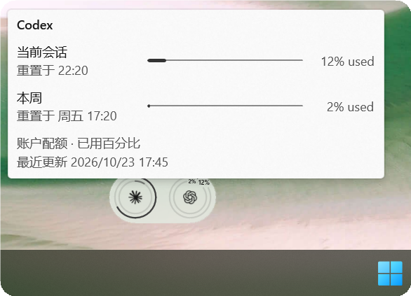
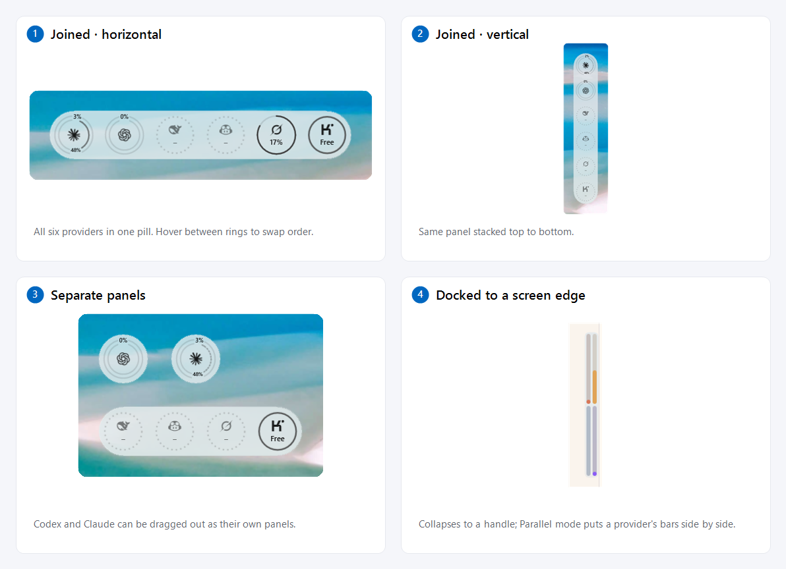
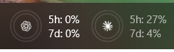
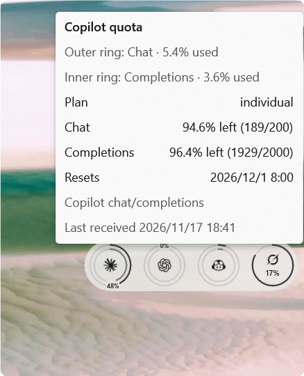
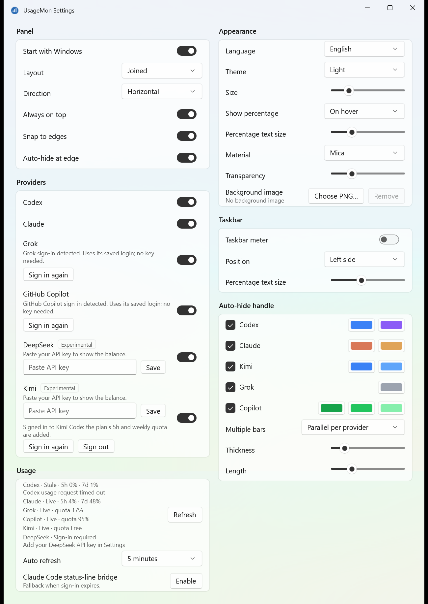

# UsageMon · 用量悬浮窗

Just another simple floating/taskbar monitor, that's all of it.

For your AI usage in WinUI3 style, with Mica and Arcylic material.

Providers: Claude Code and Codex (ChatGPT) quotas, GitHub Copilot and Grok (xAI) quotas, plus experimental DeepSeek and Kimi (API balance, and the Kimi Code plan quota after a browser sign-in). Each one is a toggle in Settings → Providers; Grok and Copilot reuse the sign-in you already have, or sign in from Settings.

一个简单的 WinUI3 风格的 AI 用量显示悬浮窗，可选云母、亚克力材质，支持 Claude、ChatGPT（Codex）、GitHub Copilot、Grok，以及实验性的 DeepSeek 和 Kimi。

Simple and native, no expensive settings and fancy UIs. Minimal and clean, click and leave it there.

## Download

Get the latest build from [Releases](https://github.com/nathanatgit/UsageMon/releases/latest), picking x64, x86 or arm64 to match your PC.

| Build | Files | Needs |
|---|---|---|
| Self-contained | `…-portable.zip` (unzip and run `UsageMon.exe`, no install), `….msi`, `….msixbundle` | Nothing else |
| Framework-dependent (smallest) | `…-framework-dependent.zip` | [.NET 8 Runtime](https://dotnet.microsoft.com/download/dotnet/8.0) and [Windows App Runtime 2.0](https://learn.microsoft.com/windows/apps/windows-app-sdk/downloads) |

The `.msixbundle` is self-signed: import `UsageMon-signing-certificate.cer` into *Trusted People* (or *Trusted Root Certification Authorities*) before installing it.

## UI Screenshots(支持简体中文和英文）

**Panel layouts** — all six providers in a joined or separate panel, horizontal or vertical, and docked to a screen edge as an auto-hide handle (shown in *Parallel per provider* mode: a provider's bars side by side, providers end to end). The percentage text on the rings can be switched on or off in Settings.

**Taskbar meter** — rings with the 5-hour and 7-day percentages beside them.

**Provider rings** — Copilot's outer ring is chat and its inner ring completions, Kimi's are 5-hour and weekly, and Grok has a single ring. Hover for the details.

**Settings** — one Providers section with a toggle per provider.

## License

[MIT](LICENSE). Third-party notices are in [THIRD_PARTY_NOTICES.md](THIRD_PARTY_NOTICES.md).
