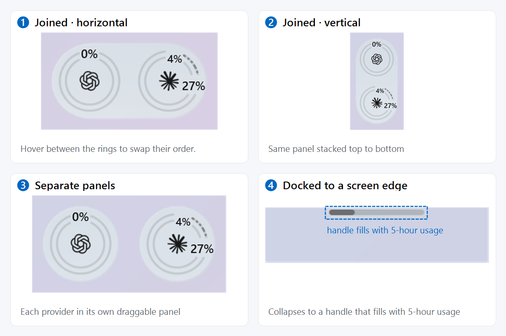
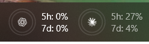
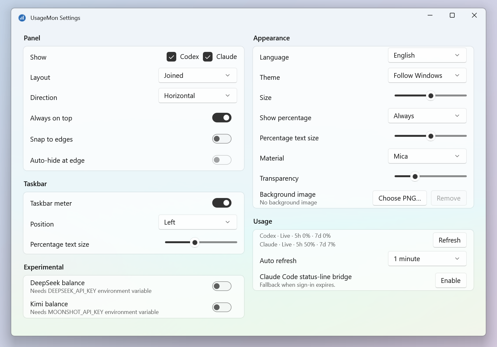
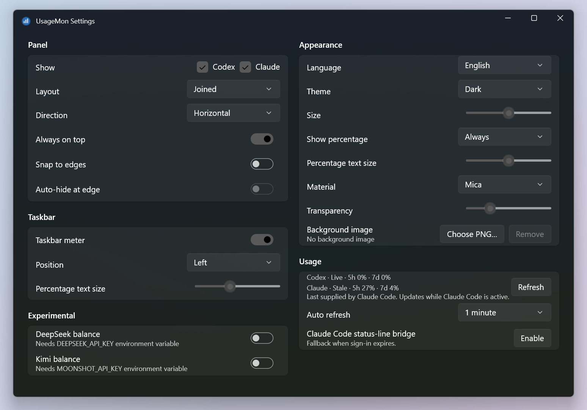

# UsageMon

UsageMon is a small native Windows 11 app, built with C# and WinUI 3, that keeps your Codex and Claude Code subscription limits in view. A floating panel of ring badges, or an optional meter beside the taskbar, shows how much of the 5-hour and weekly quota you have used, with Mica or Acrylic material, light and dark themes, English and Simplified Chinese, edge snapping with an auto-hide handle, and experimental DeepSeek and Kimi balances.

## Screenshots

**Panel layouts** — joined or separate, horizontal or vertical, and docked to a screen edge. The percentage text on the rings can be switched on or off in Settings.



**Taskbar meter** — rings with the 5-hour and 7-day percentages beside them.



**Settings** — light and dark.





## Build

Requires Windows x64 and the .NET 8 SDK (a local SDK in `.tools/dotnet` is used when present).

```powershell
.\build.ps1 -Configuration Release
& .\bin\x64\Release\net8.0-windows10.0.19041.0\win-x64\UsageMon.exe
```

Keep the whole output folder together: it is an unpackaged, self-contained app. Settings are saved to `%LOCALAPPDATA%\UsageMon\settings.json`. Codex and Claude usage is read from your existing CLI sign-ins; DeepSeek and Kimi balances need `DEEPSEEK_API_KEY` or `MOONSHOT_API_KEY` set in your environment.

## License

[MIT](LICENSE). Third-party notices are in [THIRD_PARTY_NOTICES.md](THIRD_PARTY_NOTICES.md).
